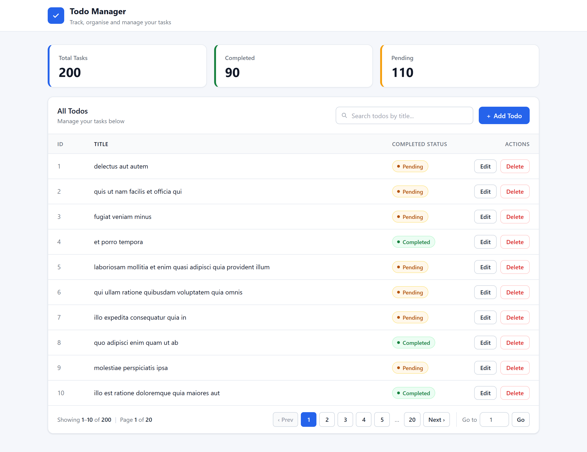
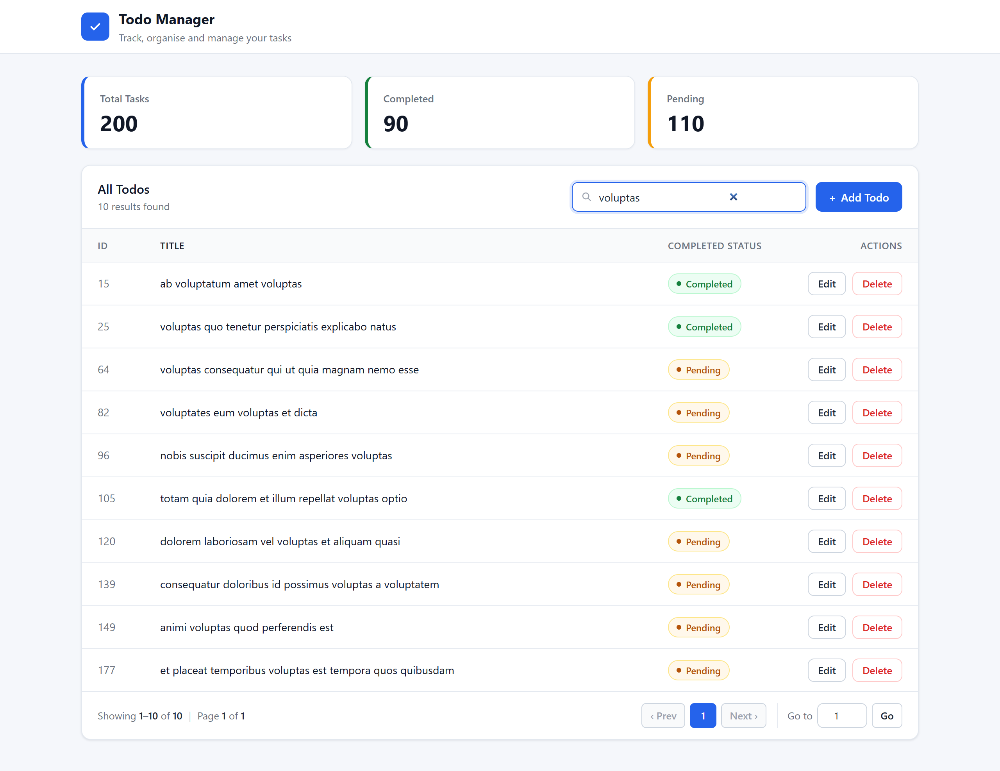
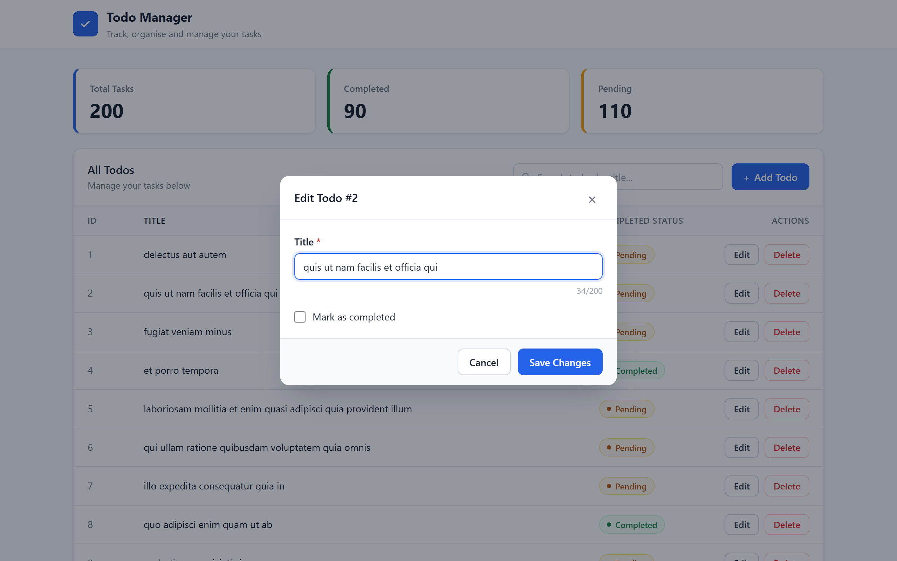

# Todo Management Application

A React app for managing todos. It uses the [JSONPlaceholder](https://jsonplaceholder.typicode.com/todos) mock REST API and supports client-side pagination, debounced search and full CRUD.

## Screenshots

**Dashboard.** Summary cards, the todo table with status badges, and pagination controls.



**Search.** Debounced, case-insensitive title search with a result count.



**Create / Edit modal.** The same form is used to add a todo or edit an existing one (shown here pre-filled).



## Features

- **Loading todos.** All todos are fetched once on page load. A loading indicator shows while the request is in progress. If the request fails, an error message appears with a **Retry** button.
- **Summary cards.** Show the Total, Completed and Pending counts. They update after every create, edit and delete.
- **Todo table.** Columns are ID, Title, Completed Status and Actions. The status column uses colour-coded *Completed* and *Pending* badges.
- **Client-side pagination**
  - Shows 10 todos per page.
  - Previous and Next buttons, numbered page buttons (with ellipsis for long ranges) and a "Go to" page input.
  - Shows the current page, the total number of pages and the range of records on screen.
  - Works on filtered results. A new search returns to page 1. After a deletion, the page is back-filled from the next page, and if the current page no longer exists, the app moves back to the previous page.
- **Debounced search**
  - Filters by title and ignores case.
  - Filtering runs about 500 ms after the user stops typing (custom `useDebounce` hook). A "Searching..." hint shows during the wait.
  - Shows a result count and a message when nothing matches.
- **Create todo**
  - Modal form with a Title field (required) and a Completed checkbox.
  - Sends a `POST` request. The new todo gets a temporary unique ID (current highest ID + 1) and is added to the top of the list.
- **Edit todo**
  - The same modal form opens filled in with the selected todo.
  - Sends a `PUT` request and updates the row in place without reloading the page.
- **Delete todo.** Asks `window.confirm("Are you sure you want to delete this todo?")`, sends a `DELETE` request, then removes the row.
- **Form validation**
  - The title is required, must be 3–200 characters, and is trimmed before saving.
  - Errors appear under the field after the user first leaves it (blur) or tries to submit.
- **Loading and error states**
  - Submit and Delete buttons show spinners while a request is running, and controls are disabled to prevent double submits.
  - When a save fails, the error appears inside the form so the user's input is kept.
  - Success messages close on their own after a few seconds.
- **Responsive layout.** On small screens the table rows turn into stacked cards, and the toolbar and pagination wrap.
- **Accessibility.** Labelled inputs, `aria-invalid` on the title field, `aria-current` on the active page, and a modal that closes with Escape or a click on the backdrop.

## About JSONPlaceholder

JSONPlaceholder does **not** save changes. `POST`, `PUT` and `DELETE` return successful responses, but the data on the server stays the same. The app therefore updates its local React state after each successful response, and the UI always shows what the user has done.

Two side effects of using a mock API:

1. **IDs for new todos.** `POST /todos` always returns `id: 201`, so the app generates its own temporary unique ID.
2. **Editing a todo you created.** The server has never stored that todo, so `PUT /todos/{id}` returns 404. For these local todos (ID > 200), the edit changes local state only and no request is sent. Todos that came from the server always send a real `PUT`.

## Technologies

| Purpose             | Technology                                              |
| ------------------- | ------------------------------------------------------- |
| UI library          | React 18 (functional components and hooks)              |
| Build tool / dev server | Vite 6                                              |
| Language            | JavaScript (ES modules, JSX)                            |
| HTTP client         | Axios                                                   |
| Styling             | Plain CSS with CSS custom properties (no UI framework)  |
| Testing             | Vitest, React Testing Library, jsdom                    |

The app uses the hooks `useState`, `useEffect`, `useMemo` and `useCallback`, plus two custom hooks: `useTodos` and `useDebounce`. All form inputs are controlled components.

## Getting Started

### Prerequisites

- Node.js 18 or later (built and tested with Node 24)
- npm
- An internet connection (the app calls JSONPlaceholder)

### Installation & Running

```bash
# 1. Install dependencies
npm install

# 2. Start the development server
npm run dev
```

Then open **http://localhost:5173** in your browser.

### Other scripts

```bash
npm run build     # Production build into dist/
npm run preview   # Serve the production build locally
npm test          # Run the test suite once
```

## Project Structure

```
├── index.html
├── vite.config.js
├── public/
│   └── favicon.svg
└── src/
    ├── main.jsx                  # App entry point
    ├── App.jsx                   # Page layout: search, pagination, modal and notification state
    ├── api/
    │   └── todoApi.js            # Axios instance, CRUD calls, error-message helper
    ├── hooks/
    │   ├── useTodos.js           # Todo state + load/create/update/delete logic
    │   └── useDebounce.js        # Generic debounce hook (500 ms for search)
    ├── utils/
    │   └── pagination.js         # Page size, slicing and page-number helpers
    ├── components/
    │   ├── Header.jsx
    │   ├── SummaryCards.jsx
    │   ├── SearchBar.jsx
    │   ├── TodoTable.jsx
    │   ├── TodoRow.jsx
    │   ├── StatusBadge.jsx
    │   ├── Pagination.jsx
    │   ├── Modal.jsx
    │   ├── TodoForm.jsx          # Controlled create/edit form with validation
    │   ├── Alert.jsx
    │   └── Spinner.jsx
    ├── styles/
    │   └── index.css
    └── test/
        ├── setup.js
        ├── App.integration.test.jsx   # Full user flows against the live API
        └── App.errors.test.jsx        # Failure scenarios (API module mocked)
```

## Testing

`npm test` runs 10 tests:

- **Integration tests** render the whole app in jsdom and call the live JSONPlaceholder API. They cover:
  - initial load and the summary cards;
  - Previous, Next, page-number and "Go to" navigation;
  - debounced, case-insensitive search, including that results are not filtered before the delay ends and that the filtered results paginate;
  - create with validation and unique temporary IDs;
  - edit of both server todos and locally created todos;
  - delete with the confirmation prompt;
  - moving back a page when the last item on the last filtered page is deleted.
- **Error tests** mock the API module. They check the load error and Retry, a failed update (the form stays open and shows the error), and a failed delete (the row stays and an error appears).
